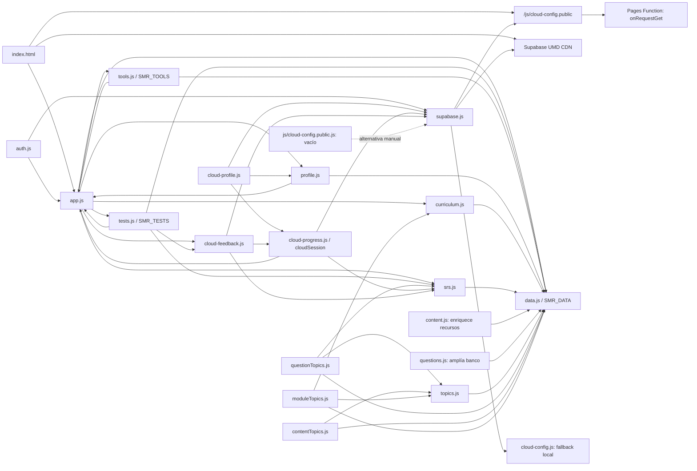

# SMR_Hub — informe de dependencias, DOM y eventos

Fecha: 23 de octubre de 2026. Análisis con Graphify y revisión local siguiendo Ponytail. No se ha modificado código de la aplicación.

Resultado: **139 selectores literales distintos no aparecen en el HTML estático, pero tienen construcción en JavaScript; no se confirma ninguno huérfano. Hay una función exportada completamente sin uso y varias exposiciones de API innecesarias. No se confirma acumulación de listeners en los ciclos actuales. Se reproducen dos fallos de integración: una exportación ausente y un listener SRS que se consume prematuramente.**

## Grafo y alcance

El workspace `Angel's workspace` quedó disponible tras completar el acceso y se seleccionó en el conector como `angel-s-workspace-d6f221`. SMR_Hub está indexado en [Graphify](https://app.graphify.com/angel-s-workspace/graph?repo=SMR_Hub).

| Evidencia | Resultado |
|---|---|
| Repositorio | `NormalGuy749/SMR_Hub` |
| Commit indexado / HEAD local | `b2c27ba10380f4335572c18b15fdfa9e8aeaeca0` |
| Build Graphify | `61066b5b-6423-4796-b01e-9a66ecc9069b` |
| Grafo completo del repositorio | 678 nodos, 1.355 relaciones, 47 comunidades; incluye pruebas |
| Subgrafo exportado | 510 nodos, 1.152 relaciones; expansión de los módulos con símbolos, sin truncamiento de esa consulta |
| Código de producción revisado | Los 20 archivos de `js/`, `functions/js/cloud-config.public.js` y los 2 HTML de la raíz |
| Consultas DOM | 202 lugares: 198 consultas literales, 3 construidas dinámicamente y el cuerpo del helper `$` |
| Selectores literales distintos | 159: 20 con coincidencia en `index.html`, 139 sin coincidencia estática |
| Registros `addEventListener` | 122 lugares: app 76, auth 5, cloud-profile 1, cloud-progress 2, tests 20, tools 18 |

El [JSON exportado de Graphify](C:/Users/angel/OneDrive/Escritorio/SMR/SMR/SMR_HUB_GRAFO.graphify.json) conserva los nodos, aristas, procedencia, commit y límites de la consulta. Es un subgrafo, no una exportación de los 678 nodos completos.

Graphify reconoce los 21 archivos JS consultados, pero `imports_exports` devuelve cero imports en todos ellos y no encuentra los HTML. Esto es coherente con una aplicación basada en scripts clásicos y globals, aunque deja incompleto el mapa de dependencias. Además, `callers(bindFav)` encuentra tres llamadores, mientras que el código local contiene cinco llamadas, incluidas las de los callbacks de filtrado. Por tanto, **cero aristas en Graphify no basta para declarar dead code**. Se contrastaron las referencias con el AST local, búsquedas en JS/HTML y las pruebas existentes, incluidos los diagnósticos ignorados en `scratch_*`.

La copia local contiene modificaciones previas sin commit en `index.html`, `js/app.js`, `js/auth.js`, `js/cloud-profile.js` y pruebas. Las líneas de este informe corresponden a esa copia. El grafo remoto describe el commit, no esas modificaciones. `backup_6c/` y las copias `backup_*` no se consideran consumidores activos; `auditor.js` es una herramienta de desarrollo ignorada, no un script cargado por la página.

### Dependencias de los módulos

Las flechas indican **consumidor → proveedor**. Las relaciones de esta vista se reconstruyeron del código y complementan las aristas de Graphify.

`index.html` carga además todos los scripts de aplicación anteriores mediante `defer`, en el orden de sus etiquetas; las flechas de carga se simplifican en el dibujo. El bloque inline de configuración usa `document.write` y solicita la Function sin la última extensión `.js`. El otro bloque inline restaura preferencias de aspecto; el JSON-LD no es código ejecutable. `googlecc9830d2dfa72d57.html` contiene únicamente la verificación de Google.

Los ciclos app ↔ tools/tests/profile son referencias a APIs compartidas; varias se resuelven cuando se invocan funciones, después de cargar los scripts. No son ciclos de imports ES. `content.js` y `questions.js` mutan `SMR_DATA` antes de que SRS construya su índice. Los módulos de topics construyen índices bajo demanda.

Hay también dependencias por eventos: `auth.js` emite `smr:authchange`, escuchado por app, cloud-profile y cloud-progress; cloud-feedback emite `smr:feedbackready`, escuchado por app; cloud-progress escucha `storage`; app escucha `hashchange`. El estado sincronizado vive en localStorage y Supabase, no en los nodos del DOM.

## 1. Selectores DOM sin coincidencia en HTML

**Resultado literal: 139 selectores distintos ausentes de los archivos HTML. Resultado funcional: cero selectores huérfanos confirmados tras revisar sus productores dinámicos.**

El [inventario completo de selectores](C:/Users/angel/OneDrive/Escritorio/SMR/SMR/SMR_HUB_SELECTORES.md) enumera los 139, cada consulta y la primera evidencia de construcción en JS. La coincidencia de producción no es una prueba de que el elemento exista en todos los estados: también se revisaron las condiciones y el ámbito de las consultas.

| Familia / ejemplo | Consulta | Por qué no está en HTML y cuándo existe |
|---|---|---|
| `#res-search`, `#res-level`, `#res-list`, `#res-clear` | [app.js:1505](C:/Users/angel/OneDrive/Escritorio/SMR/SMR/js/app.js:1505) | `renderRecursos` inserta controles; `#res-clear` solo se consulta en el bloque de lista vacía que acaba de crearlo. |
| `#glo-*`, `.chip`, `.chip-bar` | [app.js:1661](C:/Users/angel/OneDrive/Escritorio/SMR/SMR/js/app.js:1661) | Controles y resultados de glosario generados por la vista. |
| `#curr-*`, `#pf-*`, `[data-edit-profile]` | [app.js:2102](C:/Users/angel/OneDrive/Escritorio/SMR/SMR/js/app.js:2102) | Currículo, ficha del estudiante y modal de perfil. |
| `#setting-*`, `#feedback-*` | [app.js:2431](C:/Users/angel/OneDrive/Escritorio/SMR/SMR/js/app.js:2431) | Configuración; feedback es condicional y `wireFeedback` comprueba sus nodos antes de usarlos. |
| `.modal-close`, `.modal-title`, `[data-complete]`, `[data-sa]` | [app.js:1441](C:/Users/angel/OneDrive/Escritorio/SMR/SMR/js/app.js:1441) | El constructor del modal genera su contenido antes de enlazar los eventos. |
| `.auth-nav-item`, `[data-auth-*]`, `[data-view]`, `form` | [auth.js:89](C:/Users/angel/OneDrive/Escritorio/SMR/SMR/js/auth.js:89) | `createElement` + `className`, widget y plantillas de autenticación. Las búsquedas del formulario de recuperación son comprobaciones opcionales de estado. |
| `#quiz-*`, `#exam-*`, `#adaptive-start`, `[data-report-*]`, `[data-srs-*]` | [tests.js:658](C:/Users/angel/OneDrive/Escritorio/SMR/SMR/js/tests.js:658) | Plantillas de índice, pregunta, resultados, reporte y confirmación SRS. `#quiz-timer` puede faltar y tiene guarda. |
| `#study-*`, `[data-explain]`, `[data-case-opt]` | [app.js:2809](C:/Users/angel/OneDrive/Escritorio/SMR/SMR/js/app.js:2809) | Pasos de estudio y casos; continuar/terminar son condicionales y se comprueba su presencia. |
| `#sub-*`, `#st-*`, `#vlsm-*`, `#pass-*`, `#un-*`, `#ports-*`, `[data-set]` | [tools.js:58](C:/Users/angel/OneDrive/Escritorio/SMR/SMR/js/tools.js:58) | Cada `build*` crea una sección y consulta dentro de ella. `:checked` filtra el estado de los checkboxes. |
| `.palette-*`, `.search-item`, `.mobile-nav-*`, `.nav-link` | [app.js:3346](C:/Users/angel/OneDrive/Escritorio/SMR/SMR/js/app.js:3346) | Navegación, resultados de búsqueda y paleta construidos en JS; `.active` se aplica al seleccionar. |

Las tres consultas construidas dinámicamente tampoco son huérfanas:

- [app.js:226](C:/Users/angel/OneDrive/Escritorio/SMR/SMR/js/app.js:226): `[data-fav="${kind}:${id}"]`; productores de recursos y términos en las líneas 1262, 1425, 1608 y 1701.
- [app.js:1299](C:/Users/angel/OneDrive/Escritorio/SMR/SMR/js/app.js:1299): `[${attr}]`; el único llamador pasa `data-nav` y las plantillas lo crean.
- [tools.js:747](C:/Users/angel/OneDrive/Escritorio/SMR/SMR/js/tools.js:747): `#tool-${CSS.escape(tool)}`; siete `section.id` cubren los enlaces emitidos por `searchEntries`. Una herramienta desconocida retorna sin acceder a `null`.

El helper `$` en app.js:14 recibe selectores de sus llamadores; no se cuenta como un selector adicional distinto. Los 20 selectores que sí encuentran algún elemento estático incluyen las referencias de arranque, `#mobile-nav`, `.skip-link`, `input`, el meta description y las dos consultas generales de elementos enfocables. Que estas últimas coincidan en el documento no implica que se usen sobre él: sus ámbitos reales son modal y paleta.

## 2. Exportaciones sin uso y dead code

En el navegador, «exportación» significa aquí propiedad expuesta en `window.SMR`, `SMR_TESTS` o `SMR_TOOLS`. No hay exports ES en esos scripts.

### Código completamente sin consumidores

**P3 — `SMR_TESTS.studyBlocks`**: definida en [tests.js:1313](C:/Users/angel/OneDrive/Escritorio/SMR/SMR/js/tests.js:1313), expuesta en [tests.js:1352](C:/Users/angel/OneDrive/Escritorio/SMR/SMR/js/tests.js:1352). Graphify devuelve cero callers y cero referencias; la búsqueda local en aplicación, HTML, tests y diagnósticos tampoco encuentra llamadas. El modo estudio utiliza su propio [buildStudyPlan](C:/Users/angel/OneDrive/Escritorio/SMR/SMR/js/app.js:2562) y `SMR_TESTS.studyQuestion`, por lo que `studyBlocks` no participa en el flujo. Cambio mínimo propuesto: eliminar esa función y su entrada del objeto retornado, sin tocar `studyQuestion`.

### Exposiciones sin consumidores; su implementación interna sí puede usarse

Estas entradas no tienen lecturas externas localizadas. Retirar la propiedad exportada no equivale a borrar la función o constante que la implementa.

| Entradas expuestas | Ubicación | Acción mínima propuesta |
|---|---|---|
| `SMR.feedback.CATEGORIES`, `.REASONS`, `.LIMITS` | [cloud-feedback.js:205](C:/Users/angel/OneDrive/Escritorio/SMR/SMR/js/cloud-feedback.js:205) | Quitar solo estas tres entradas públicas. Las constantes locales siguen validando los envíos. `LIMITS` aparece en un mock, pero no se consume desde la API. |
| `SMR.profile.KEYS`, `.store`, `.getCurriculum`, `.getModules` | [profile.js:174](C:/Users/angel/OneDrive/Escritorio/SMR/SMR/js/profile.js:174) | Quitar las cuatro entradas si no se desea mantener esa API pública. Los helpers siguen usados internamente y a través de `SMR.getStudentCurriculum` / `SMR.getStudentModules`. |
| `SMR.topics.version` | [topics.js:379](C:/Users/angel/OneDrive/Escritorio/SMR/SMR/js/topics.js:379) | Quitar solo la propiedad sin lectores; mantener `TAXONOMY_VERSION`, usada por el validador. |
| `SMR.__curriculumInternals.canonicalCourse`, `.courseSegment`, `.baseModuleId`, `.normalizeCourse` | [curriculum.js:325](C:/Users/angel/OneDrive/Escritorio/SMR/SMR/js/curriculum.js:325) | Quitar esas exposiciones. Los helpers siguen siendo necesarios dentro del módulo. `slug` y `buildIndex` sí tienen consumidores en pruebas históricas. |
| `SMR.__moduleTopicsInternals.EQUIV_RULES`, `.buildIndex` | [moduleTopics.js:537](C:/Users/angel/OneDrive/Escritorio/SMR/SMR/js/moduleTopics.js:537) | Quitar solo esas dos exposiciones; conservar los valores internos y `CODE_LINKS`, leído por diagnósticos históricos. |

Son **14 entradas de API sin consumidores encontrados**, agrupadas en la tabla. Esto no autoriza a borrar la validación interna ni sus datos. No se ha aplicado ninguna eliminación.

### APIs sin uso en la interfaz, pero con consumidores de diagnóstico

No se clasifican como «no usadas en ningún sitio»:

| API / módulo | Consumidores que evitan el falso positivo |
|---|---|
| `contentTopics`, `topicOfResource`, `topicsOfResource`, `topicOfCase`, `topicsOfCase`, `resourcesOfTopic`, `casesOfTopic` | `scratch_6d5/test_content_topics.js`, `scratch_6d8/test_6d8.js`, `scratch_6d9/auditoria_6d9.js`. No se usan en la interfaz actual. |
| `questionTopics`, `topicOf`, `questionsOfTopic`, `validateQuestionTopics` | `scratch_6d4/test_question_topics.js` y auditorías 6D.8/6D.9. `topicOf` local de tests.js es otra función distinta. |
| `moduleTopics`, `topicsOfModule`, `modulesOfTopic`, `topicOfModule`, `moduleEquivalences`, `equivalentModules` | Pruebas de `scratch_6d6`, `scratch_6d8` y `scratch_6d9`; además `moduleEquivalences` es llamada por su validador. |
| `getCurriculumModules`, `getModule`, `findModules` | `scratch_6d2/test_curriculum_index.js`, `scratch_6d8/test_6d8.js` y `scratch_6d9/auditoria_6d9.js`. `findModules` también sirve a `getModule`. |
| Validadores de currículo, contenido, módulos y equivalencias | [content-integrity.test.js:237](C:/Users/angel/OneDrive/Escritorio/SMR/SMR/tests/content-integrity.test.js:237). No eliminar por no tener llamadas de UI. |
| `topics.validateTopics`, `topics.registeredRawTopics`, `srs.isStableKey`, `srs.questionHashInput`, `profile.clear`, `profile.COURSES` | Validación interna y/o pruebas históricas: `scratch_6d3`, `scratch_6c5`, `scratch_6d9`, `scratch_fase55`, `scratch_spacing`. |
| `SMR.auth.open`, `SMR.cloudSession.transitionPending`, `SMR.srs.buildIndex` | Pruebas activas de autenticación, propietario del slot y SRS. |
| `onRequestGet` | [functions/js/cloud-config.public.js:39](C:/Users/angel/OneDrive/Escritorio/SMR/SMR/functions/js/cloud-config.public.js:39): entrada invocada por Cloudflare Pages. La ausencia de imports locales no la vuelve dead code. |

Las capas de topics son candidatas a revisar por coste de carga, pero quitar sus scripts exigiría decidir antes qué API de diagnóstico se quiere conservar. Esa decisión no forma parte de este informe.

### Dependencia rota encontrada al verificar exportaciones

**P2 — `SMR.openResource` no existe.** [tests.js:739](C:/Users/angel/OneDrive/Escritorio/SMR/SMR/js/tests.js:739), [tests.js:958](C:/Users/angel/OneDrive/Escritorio/SMR/SMR/js/tests.js:958) y [tests.js:961](C:/Users/angel/OneDrive/Escritorio/SMR/SMR/js/tests.js:961) la llaman desde los botones de repaso y recomendaciones. [app.js:1327](C:/Users/angel/OneDrive/Escritorio/SMR/SMR/js/app.js:1327) declara `function openResource`, pero no la asigna a `SMR`. Con los módulos reales cargados en Node/vm se obtiene `typeof openResource === 'function'` y `typeof SMR.openResource === 'undefined'`. El clic ejecutaría una llamada a una propiedad inexistente. Cambio mínimo propuesto: exponer la función existente en `SMR.openResource`; no duplicar su implementación. Este fallo es de API, no de selector DOM.

## 3. Listeners acumulativos y manipulación del DOM

**No se ha encontrado un camino actual de render que vaya sumando listeners sobre el mismo nodo persistente.** No basta con encontrar `addEventListener` dentro de un render: hay que comprobar si el nodo se conserva, se sustituye o se limpia.

| Flujo revisado | Ciclo de vida observado | Resultado |
|---|---|---|
| `render()` del router | [app.js:3443](C:/Users/angel/OneDrive/Escritorio/SMR/SMR/js/app.js:3443) vacía `#content` antes de renderizar; detiene temporizadores de test y estudio. | Los eventos de los descendientes anteriores no se vuelven a adjuntar a esos mismos nodos. |
| Recursos / glosario → `bindFav` | [app.js:1537](C:/Users/angel/OneDrive/Escritorio/SMR/SMR/js/app.js:1537) y [app.js:1693](C:/Users/angel/OneDrive/Escritorio/SMR/SMR/js/app.js:1693) reemplazan la lista antes del binding. Los inputs de filtro se enlazan una vez por construcción de vista. | Sin acumulación en las llamadas actuales; `bindFav` no es idempotente si alguien lo reutilizara dos veces sobre el mismo DOM. Esto último es un límite, no un fallo reproducido del flujo actual. |
| Modal → listener `document.keydown` | [app.js:825](C:/Users/angel/OneDrive/Escritorio/SMR/SMR/js/app.js:825) cierra el anterior; [app.js:849](C:/Users/angel/OneDrive/Escritorio/SMR/SMR/js/app.js:849) guarda cleanup y [app.js:860](C:/Users/angel/OneDrive/Escritorio/SMR/SMR/js/app.js:860) lo ejecuta. | Comprobación con DOM simulado: 20 aperturas mantienen uno; cerrar deja cero. |
| Paleta de comandos | [app.js:3623](C:/Users/angel/OneDrive/Escritorio/SMR/SMR/js/app.js:3623) reemplaza items antes de enlazarlos; el overlay se elimina al cerrar. Los listeners globales se registran en `wirePalette`, llamada desde `init`. | Sin registro global por cada búsqueda/apertura. |
| Auth: widget y formulario | [auth.js:96](C:/Users/angel/OneDrive/Escritorio/SMR/SMR/js/auth.js:96), [auth.js:266](C:/Users/angel/OneDrive/Escritorio/SMR/SMR/js/auth.js:266). Se sustituye el contenido del widget y se crea un modal nuevo. La suscripción al SDK se hace desde el único `init`. | Sin acumulación por refresco del widget o cambio de formulario. |
| Tests, reportes, borrado SRS | [tests.js:658](C:/Users/angel/OneDrive/Escritorio/SMR/SMR/js/tests.js:658), [tests.js:892](C:/Users/angel/OneDrive/Escritorio/SMR/SMR/js/tests.js:892). Los controles se crean antes de `wireReport`, `wireSrsDrop` y `wireSrsRating`. | No se observa rebinding acumulativo; hay un fallo de duración del listener SRS, descrito debajo. |
| Herramientas | [tools.js:731](C:/Users/angel/OneDrive/Escritorio/SMR/SMR/js/tools.js:731): `replaceChildren` recibe secciones nuevas; `compute()` actualiza resultados sin reenlazar inputs. | Sin acumulación al recalcular. |
| Cloud | [cloud-profile.js:275](C:/Users/angel/OneDrive/Escritorio/SMR/SMR/js/cloud-profile.js:275), [cloud-progress.js:1925](C:/Users/angel/OneDrive/Escritorio/SMR/SMR/js/cloud-progress.js:1925), [cloud-progress.js:1944](C:/Users/angel/OneDrive/Escritorio/SMR/SMR/js/cloud-progress.js:1944). Guardas `wired` y `storageWired`. | Los renders no vuelven a registrar esos listeners. |

**P2 — listener SRS consumido prematuramente.** [tests.js:1195](C:/Users/angel/OneDrive/Escritorio/SMR/SMR/js/tests.js:1195) usa `{ once: true }` en cada botón de `wireSrsRating`. La fila se conserva al cambiar de valoración: solo se actualizan clases, `aria-pressed` y el estado de borrado. Tras la secuencia «Lo sabía → No lo sabía → Lo sabía», el tercer clic ya no tiene listener. Reproducción con `EventTarget` real de Node y la función extraída del fuente: tres clics registran únicamente `[2, 0]`. No es acumulación, sino pérdida del listener necesario para volver a valorar. Cambio mínimo propuesto: quitar `{ once: true }` en esta función, manteniendo un binding por fila recién renderizada.

La suite [srs-rate-ui.test.js:47](C:/Users/angel/OneDrive/Escritorio/SMR/SMR/tests/srs-rate-ui.test.js:47) no modela las opciones de `addEventListener`; su mock conserva el callback e ignora `once`. Por eso pasa sin detectar esta secuencia. Al corregirlo, conviene cubrir `2 → 0 → 2` con semántica real de eventos; no cambiar indiscriminadamente los otros listeners `once`, como los de contestar una pregunta.

## Verificación y límites

- Sintaxis: los 20 scripts de `js/` y la Function pasan `node --check`.
- Pruebas existentes: feedback UI 9/9, SRS rating UI 5/5, integridad del contenido 13/13 y SEO 7/7. Total: 34 comprobaciones aprobadas; sus mocks no prueban todos los comportamientos del navegador.
- [Comprobaciones reproducibles de la auditoría](C:/Users/angel/OneDrive/Escritorio/SMR/SMR/scratch_graphify/checks.cjs): reproducen la exportación ausente, la secuencia SRS y la limpieza del listener del modal. Ejecutar `node scratch_graphify/checks.cjs` desde la raíz. Los dos primeros resultados confirman defectos existentes, no correcciones.
- Inventario local: extracción AST con Acorn incluido en Node, búsqueda de productores de HTML y revisión manual de atributos multilínea/interpolados. No se instalaron dependencias.
- El navegador conectado no pudo alcanzar el servidor local de auditoría (`ERR_CONNECTION_TIMED_OUT`); no se presenta la prueba de navegación completa ni medición de memoria del navegador como ejecutadas. Los resultados de eventos combinan análisis de código, pruebas existentes y el arnés Node descrito.
- No se ejecutaron operaciones contra Supabase real, pruebas PostgreSQL/RLS ni cambios de sesión reales; tampoco se modificaron la aplicación, sus tests existentes o los datos del usuario.

Se omitieron correcciones y funcionalidades nuevas porque se solicitó un informe. Riesgo conocido: el grafo remoto no incorpora cambios locales y los consumidores externos al repositorio no pueden descartarse antes de eliminar una API.
